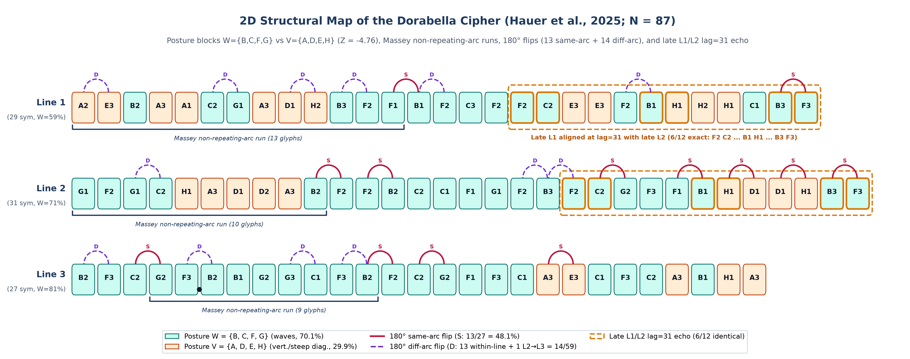
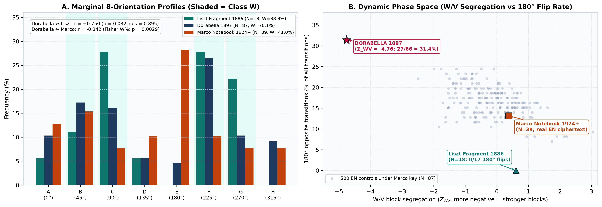

# The Dorabella Cipher (1897): What Elgar's Hand Reveals That Letters Never Did

> **For nearly 90 years, codebreakers treated Edward Elgar's famous 87-symbol letter as a string of secret letters. We stopped looking at abstract "letters" — and looked at the 2D movement of Elgar's pen on the paper.**

[-1E3A5F)](paper/dorabella_2d_geometry.pdf)
[](paper/dorabella_2d_geometry.tex)
[](#reproduce-everything-in-35-seconds)
[](LICENSE)

*Version française disponible dans le dépôt jumeau francophone (ou consultez directement [`REPORT.md`](REPORT.md) et [`report.html`](report.html)).*

---

## The 60-Second Story (No Math Required)

On **July 14, 1897**, British composer **Edward Elgar** sent a strange little note to twenty-two-year-old Dora Penny ("Dorabella"): 87 looping, semicircular squiggles arranged in three lines, facing eight compass directions with 1, 2, or 3 loops each. Nobody has ever produced an accepted decipherment.

Recent research showed a strange paradox: modern codebreaking software cracks 88%–99% of 87-character English and Latin ciphers yet completely fails on Dorabella (Hauer et al., 2021; Wase, 2023/2025) — while AI hoax detectors still hesitate, because the *symbol frequencies* look superficially English-like (Foxon, 2024, 2025).

**Why?** Because those algorithms only see **1D abstract IDs** (`Symbol #1`, `Symbol #2`…). They are blind to how the shapes are actually drawn.

When we restored the **2D geometry of the pen strokes**, four unmistakable physical fingerprints jumped off the page:



### 1. The Pen Gets "Stuck" in Posture Blocks
Elgar's 8 orientations naturally split into two very different wrist postures:
* **Waves `W = {B, C, F, G}`** (teal): horizontal and slanted cursive waves (`m`, `w`) that flow effortlessly across the page (**70.1%** of the note).
* **Upright / Steep `V = {A, D, E, H}`** (amber): vertical (`ε`, `3`) and awkward steep diagonals (**29.9%**).

In a real encrypted English sentence, these two postures should mix constantly. In Dorabella, they travel in **long, homogeneous blocks** — up to **20 cursive waves in a row** across the Line 2 → Line 3 break! Only **18 of 86 transitions** cross between `W` and `V` (`Z = -4.76`). Out of **1,000 real English ciphers** tested across all 35 possible 4-vs-4 splits, **not a single one** gets anywhere near this (`0 / 1,000`, $p_{\text{corr}} < 0.001$).

### 2. The $180^\circ$ Mirror Reflex
Whenever Elgar repeats the same number of loops from one glyph to the next, **nearly half the time (`13 / 27 = 48.1%`) the symbol flips completely upside-down by $180^\circ$** — just like a human doodler unconsciously thinking *"I just drew a wave pointing up, now let me flip it down."* Even after locking the `W/V` posture blocks in place, this mirror reflex stays overwhelmingly significant (`p = 0.0012`).

### 3. Wrist Ergonomics Beat Alphabet Frequencies
Every orientation and its exact $180^\circ$ opposite share almost the exact same loop-count habit:
* **Upright strokes (`A` ↔ `E`)**: tall **3-loop** shapes (`85%` are 3 arcs).
* **Slanted cursive waves (`B` ↔ `F`)**: comfortable **2-loop** peak.
* **Awkward steep diagonals (`D` ↔ `H`)**: almost always **1 single loop**, with **zero** 3-loop glyphs (`D3 = H3 = 0`).

Out of all **105 possible ways** to pair up the 8 orientations, exact $180^\circ$ opposites rank **#1 out of 105** (`cosine = 0.9746`, `p = 0.0095`). Letters of the alphabet have no reason to obey wrist comfort!

### 4. The Smoking Gun Across Elgar's Own Manuscripts (1886 → 1897 → 1924+)
We ran the first systematic statistical comparison across **all three surviving Elgar manuscripts** written in this semicircle script:



* **1886 *Liszt Fragment* (`N = 18`):** Written in pencil on a concert programme *11 years before* Dorabella. It shares the **exact same favorite orientations** (`r = +0.750, p = 0.032`, `W = 88.9%`, peak on `F`) — which directly refutes claims that Dora Powell forged Dorabella in 1937! Yet Liszt has **zero** $180^\circ$ flips (`0 / 17`).
* **1924+ *Marco Elgar Notebook* (`N = 39`):** Real, decipherable English written by Elgar about his spaniel Marco using the same semicircle alphabet. **Every single Dorabella quirk vanishes** (`W = 41.0%`, Fisher `p = 0.0029`; `Z_WV = +0.38`; ordinary $180^\circ$ rate). Out of **500 English messages** encrypted with Elgar's own 1924 key, **`0 / 500`** match Dorabella's posture blocking or $180^\circ$ flip rate.

---

## Bottom Line: What Is the Dorabella Cipher?

The simplest unified explanation — confirmed by out-of-sample model selection (**`+12.03` nats** over independence, Bayes factor $\approx 167{,}000:1$) and 500-trial generative simulations (**calligraphic model `1.09σ`** vs English MASC `2.94σ` and Elgar musical encodings `3.77σ`–`10.64σ`) — is a **playful improvised calligraphic pseudo-cipher drawn by Elgar himself in 1897**, riffing on his favorite personal squiggles from 1886 rather than encoding an 87-letter English, Latin, or musical message.

> **A Challenge for Future Codebreakers:** Statistics alone cannot prove logical impossibility (remember the Zodiac Z340 cipher!). However, any future decipherment proposal now has a crisp quantitative crash-test: it must explain *how* its encoding produces **$Z_{WV} = -4.76$**, **#1/105 $180^\circ$ arc symmetry**, and a **48.1% same-arc mirror flip rate** all at once.

---

## Summary of Exact Metrics (`data/results_summary.json`)

| Test / Benchmark | Dorabella (`Hauer_2025`) | Key Comparison / Calibration |
| :--- | :---: | :--- |
| **`W/V` posture blocks** (`W={B,C,F,G}` vs `V={A,D,E,H}`) | **`18 / 86` crossings** (`Z = -4.761`) | `0 / 1,000` EN MASCs reach `min Z <= -4.76` over all 35 4+4 splits (`p_corr < 0.001`); invariant on `Hauer`, `Hartmeier`, `Pelling`. |
| **Two-layer $180^\circ$ flips** (Massey vs Rehling) | **`27 / 86` (`31.4%`)** total (`Z = +4.58`)<br>`14/59` diff-arc · **`13/27` same-arc (`48.1%`)** | Equal rate inside (`8/29 = 27.6%`) vs outside Massey runs (`p = 0.632`). Within fixed `W/V` + arcs: diff-arc NS (`p = 0.221`), **same-arc `p = 0.00124`**. |
| **$180^\circ$ arc-profile symmetry** | Mean 4-axis cosine **`0.9746`**<br>Mean `|Δarc|` = **`0.1679`** | **Exact rank `#1 / 105`** (`p = 0.00952`) on both `Hauer_2025` and `Pelling_2012`. |
| **Elgar corpus comparison** (1886 / 1897 / 1924+) | *Liszt* (`N=18`): `W=88.9%`, `0/17` $180^\circ$<br>*Marco* (`N=39`): `W=41.0%`, `5/38` $180^\circ$ | Dorabella ↔ Liszt `r = +0.750` (`p = 0.032`); Dorabella ↔ Marco Fisher `W%` `p = 0.0029`; `0 / 500` Marco-key EN controls match. |
| **LOO-CV model selection** (86 transitions) | **`W/V + 180° mirror` (+4 params)** | **`+12.03` nats** vs IID (`ppl = 6.56`), beating full $8\times 8$ Markov (`+7.81`) and optimal 1D musical chain (`+8.59`). |
| **500-trial generative adequacy** (8 metrics) | **`G2` Calligraphic (`RMS = 1.09σ`)** | Descriptive check (`G2` calibrated on Dorabella; beats EN MASC `2.94σ` and direct pitch+rhythm musical encodings `3.77σ`–`10.64σ`). |
| **Foxon-style 1D vs 1D+2D classifier** (`SVM` / `MLP`, uncalibrated 2D prior) | **1D:** `P(EN) = 0.772 / 0.973`<br>**1D+2D:** **`P(EN) = 0.0008 / 0.0016`** | 5-fold CV jumps `93.4%` → **`99.94%`** (`AUC = 0.9999`). Flips Dorabella across all 3 transcriptions while real English *Marco* (`N=39`) moves to **`P(EN) = 1.0000`**. |
| **1,000 English MASC 2D null** (`N=87`, random keys) | **`0 / 1,000`** meet all 3 signatures | Same-arc $180^\circ \ge 48.1\%$: `0/1,000` (`p = 0.001`); $\cos_{180^\circ} \ge 0.9746$: `1/1,000` (`p = 0.002`); pairwise null $|r| \le 0.22$. |

---

## Reproduce Everything in ~35 Seconds

No black boxes — every single number, p-value, JSON table, and 300-DPI figure in this repository is deterministically generated from raw transcriptions:

```bash
pip install -r requirements.txt
python3 scripts/reproduce_all.py
```

### Compile the English LaTeX Manuscript (`paper/dorabella_2d_geometry.pdf`)

```bash
cd paper
# Option A: Tectonic (single command)
tectonic -X compile dorabella_2d_geometry.tex

# Option B: Standard TeX Live / Overleaf
pdflatex dorabella_2d_geometry.tex && bibtex dorabella_2d_geometry && pdflatex dorabella_2d_geometry.tex && pdflatex dorabella_2d_geometry.tex
```

---

## What's Inside This Repository

```text
dorabella_study/
├── paper/
│   ├── dorabella_2d_geometry.pdf       # Camera-ready 7-page English paper (HistoCrypt style)
│   ├── dorabella_2d_geometry.tex       # Full LaTeX source (1-line switch for Cryptologia style)
│   ├── references.bib                  # 15 verified primary & secondary citations
│   └── figures/                        # 300-DPI English publication figures (fig1..4_en.png)
├── data/                               # Transcriptions (3 sources), Elgar corpus, JSON results
├── scripts/                            # Deterministic reproduction pipeline (01..06 + runner)
├── cipher_refutation/                  # 8 archived scripts refuting classical/exotic ciphers
├── REPORT.md & report.html             # Complete French report (Markdown + offline HTML)
├── figures/                            # 300-DPI French figures
├── CITATION.cff                        # GitHub citation metadata
└── LICENSE                             # MIT (code) + CC BY 4.0 (manuscripts & data)
```

---

## Authorship, Credits & Transparency

* **Author:** **Christophe Marcheux** *(Independent Researcher, November 20, 2026)*.
* **Computational & Drafting Assistance:** **Arena.ai Agent Mode** *(credited in Acknowledgments / Methods for computational implementation, statistical simulations, and LaTeX drafting under the author's direction, critical auditing, and full scientific responsibility)*.
* **Paywall note:** All 15 references were audited against primary texts, except Viktor Wase (*Cryptologia*, 49(1):15–24, DOI `10.1080/01611194.2023.2271466`), which is behind a publisher paywall and was verified via its official abstract, keywords (`CrypTool 2`), and secondary citations (Foxon, 2024).
