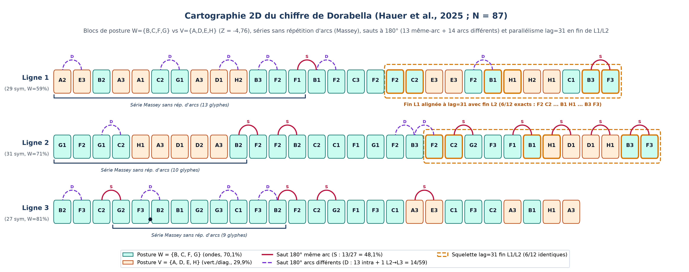
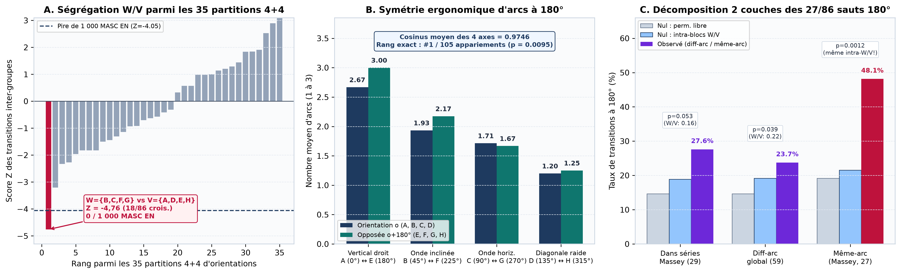
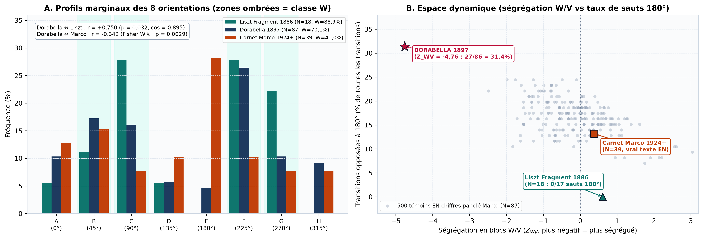
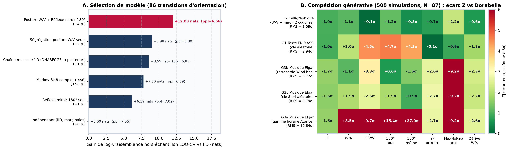

# Signatures géométriques 2D, analyse forensique du corpus d’Elgar et modélisation générative du chiffre de Dorabella (1897)

**Rapport de recherche reproductible** — *Novembre 2026*  
**Code et données** : `scripts/reproduce_all.py`, `data/transcriptions.json`, `data/elgar_corpus.json`, `data/results_summary.json`

---

## Résumé

Le *chiffre de Dorabella* (87 symboles sur trois lignes de longueurs 29, 31 et 27, accompagné de la date « July 14. 97 »), envoyé par Edward Elgar à Dora Penny et publié dans les mémoires de cette dernière en 1937, résiste depuis près de quatre-vingt-dix ans au déchiffrement. Si la littérature récente a établi que les solveurs de substitution monoalphabétique (MASC) échouent sur Dorabella malgré des taux de succès de 88 % à 99 % sur des témoins anglais ou latins de 87 caractères (Hauer et al., 2021 ; Wase, 2023/2025), les classifieurs fondés sur des statistiques 1D invariantes par permutation des symboles continuent de placer Dorabella près de la frontière entre l’anglais réel et le pseudo-aléatoire imitant l’anglais (Foxon, 2024, 2025).

En exploitant la **géométrie bidimensionnelle des glyphes** (8 orientations par pas de $45^\circ$, notées `A` à `H`, combinées à 1, 2 ou 3 demi-cercles) plutôt que leur seule identité symbolique abstraite, cette étude met au jour **quatre signatures 2D robustes** et réalise la **première comparaison statistique systématique de l’ensemble du corpus survivant d’Elgar** (1886–1924+) :

1. **Ségrégation dynamique en blocs de posture `W/V`** : les 8 orientations se scindent en deux familles géométriques fermées sous rotation à $180^\circ$ — les ondes horizontales/inclinées `W = {B, C, F, G}` (`70,1 %`) et les tracés verticaux/diagonaux raides `V = {A, D, E, H}` (`29,9 %`) — avec seulement **`18 / 86` transitions inter-groupes** contre `36,46` attendues (**$Z = -4,761$**, invariant sur `Hauer_2025`, `Hartmeier_2017` et `Pelling_2012` ; `0 / 1 000` témoins MASC anglais atteignent $\min Z \le -4,76$ sur les 35 partitions 4+4, $p_{\text{corr}} < 0,001$).
2. **Décomposition en deux couches des `27 / 86` sauts à $180^\circ$** : la généralisation des 13 paires miroir de Massey (2017) à tous les nombres d’arcs double le signal (**`27 / 86 = 31,4 %`**, $Z = +4,58$, $p < 2\times 10^{-5}$) et tranche la controverse Massey (2017) vs Rehling (2020). Les sauts à $180^\circ$ d’arcs différents (`14 / 59 = 23,7 %`) surviennent au même taux *à l’intérieur* (`8 / 29 = 27,6 %`) qu’à l’extérieur des trois séries sans répétition d’arcs de Massey (Fisher $p = 0,632$) et sont expliqués par le confinement dans les blocs `W/V` ($p_{\text{intra-W/V}} = 0,221$). À l’inverse, les transitions à $180^\circ$ **de même nombre d’arcs** atteignent **`13 / 27 = 48,1 %`** et demeurent hautement significatives **même en figeant à la fois les blocs `W/V` et les positions d’arcs** (**$p = 0,0012$** ; `OR = 2,99`, $p = 0,044$ face aux transitions d’arcs différents).
3. **Symétrie ergonomique des profils d’arcs à $180^\circ$** : chaque orientation et son opposée exacte à $180^\circ$ partagent presque exactement le même profil de nombre d’arcs (`A↔E` dominé par 3 arcs : `2,67` vs `3,00` ; `D↔H` dominé par 1 arc avec zéro 3-arc : `1,20` vs `1,25` ; `C↔G` : `1,71` vs `1,67` ; `B↔F` : `1,93` vs `2,17`). Le cosinus moyen des quatre paires opposées atteint **`0,9746`** — **rang exact #1 sur les 105 appariements possibles** des 8 orientations en 4 paires (**$p = 0,00952$**).
4. **Clivage marginal/dynamique dans le corpus complet d’Elgar** : le *Liszt Fragment* (10 avril 1886, $N = 18$) partage fortement le répertoire marginal de Dorabella (`W = 88,9 %`, pic sur `F`, corrélation directe **$r = +0,750, p = 0,032$**, arcs $\chi^2\,p = 0,881$), mais ne présente **aucun saut à $180^\circ$ (`0 / 17`)**. Le *Carnet Marco Elgar* (post-mai 1924, vrai texte anglais chiffré, $N = 39$) s’en dissocie totalement (`W = 41,0 %`, Fisher $p = 0,0029$, $r = -0,342$, arcs dominés à 62 % par 2 boucles, $\chi^2\,p = 0,023$).

Enfin, une **sélection de modèle hors-échantillon (LOO-CV)** sur les 86 transitions d’orientation montre qu’un modèle calligraphique parcimonieux à 4 paramètres (`Posture W/V + Réflexe miroir 180°`) obtient **`+12,03` nats** sur l’indépendance (facteur de Bayes $\approx 167\,000 : 1$, perplexité `6,56`), battant à la fois la chaîne de Markov $8\times 8$ complète (`+7,81` nats) et la chaîne musicale 1D optimale (`+8,59` nats). En simulation générative (500 tirages, 8 métriques), ce modèle calligraphique (`RMS = 1,09σ`) surpasse nettement le texte anglais MASC (`2,94σ`) et tous les encodages musicaux entraînés sur cinq thèmes authentiques d’Elgar (`3,77σ` à `10,64σ`).

---

## 1. État de l’art et vérification des antériorités

Avant de revendiquer toute originalité, une revue critique des sources primaires publiées entre 1970 et 2025 a été conduite afin de distinguer rigoureusement les résultats antérieurs, les observations qualitatives préexistantes et les contributions inédites de cette étude.

> **Transparence bibliographique sur Wase (2023/2025) :** l’article de Viktor Wase (*Cryptologia* 49(1):15–24, mis en ligne le 20 novembre 2023, DOI `10.1080/01611194.2023.2271466`) étant sous paywall éditeur sans prépublication libre accessible, ses résultats ont été vérifiés à partir de son résumé officiel, de ses mots-clés (`CrypTool 2`) et de la littérature qui le cite (notamment Foxon, 2024). Aucune de ces sources ne rapporte d’analyse `W/V` ni de `lag=31`, mais une relecture directe du PDF éditeur reste recommandée avant toute soumission en revue.

| Résultat / Observation | Antériorité | Références exactes et délimitation de notre apport |
| :--- | :---: | :--- |
| Échec des solveurs MASC sur anglais et latin (87 car.) | **Établi** | **Hauer et al. (2021)** (HILLCLIMBC : 88,1 % sur témoins, échec sur Dorabella) ; **Wase (2023/2025)** (CrypTool 2 : 98,7 % EN, 98,6 % LA, échec sur Dorabella et permutations simples). *Notre apport :* extension à 5 langues (`EN, IT, DE, FR, GA`), 5 régimes phonétiques/sténographiques, *backslang*, 4 transcriptions + 32 bascules visuelles, et 4 mécanismes d’inversion $180^\circ$ (`F1–F4`). |
| 13 paires miroir ($180^\circ$, **même arc**) | **Établi** | **Massey (2017)** (première observation) ; **Rehling & Pelling (2019–2021)** (correction binomiale) ; **Hauer et al. (2021, §6.4.1)** (`123 / 100 000` MASC EN, $p \approx 0,0012$, moy. `3,64`). *Notre apport :* réfutation des hypothèses « doubles lettres » (`M1a/M1b/M2`) et d’inversion $180^\circ$ (`F1–F4`). |
| Séries sans répétition d’arcs (`13, 10, 9` glyphes) | **Établi** | **Massey (2017)** ; **Jarlve (2019)** (note `8–9` dans Liszt) ; **Rehling (2020)** (signale l’exclusion mutuelle avec les miroirs de même arc) ; **Hauer et al. (2021, §6.4.2)** (`27,4 %` des MASC EN atteignent $\ge 12$). *Notre apport :* démontrer que ce critère **rejette fortement la musique d’Elgar** (`+9,2σ`). |
| 12 digrammes inversés (`RevD = 12`) | **Établi** | **Schmeh (2018, §3.5, p. 148)** (note le double du texte témoin de 1897). |
| Biais angulaires graphologiques & monotonie de L3 | **Qualitatif** | **Ernst (2017–2018, cité dans Schmeh 2021)** dresse la table `Angle × Arcs` et évoque des préférences graphologiques (`180°`, `315°` évités) + une ligne 3 distincte ; **Pelling (2019)** note la monotonie visuelle de L3 ; **Mulliss (2019)** évoque l’inclinaison des glyphes. *Notre apport :* formalisation dynamique (`W/V`), tests exacts et symétrie d’arcs. |
| Fin identique de L1 et L2 (`B3 F3`) | **Partiel** | **Novacna (2019)** et **Hauer et al. (2021, §6.4.1)** notent la paire finale `B3 F3`. *Notre apport :* pic d’autocorrélation **`lag = 31`** (`11/56`) localisé sur la 2e moitié de L1/L2 (`6/12` alignements : `F2 C2 _ _ _ B1 H1 _ _ _ B3 F3`). |
| Permutations du carnet Marco (`8! × 2`) | **Établi** | **`AmrEshra/dorabella-lab` (exp. 04–06)** teste les `80 640` permutations + mots-clés. *Notre apport :* 72 960 variantes géométriques/pigpen rotatif/carte *Courage*. |
| Classification ML 1D (anglais vs *gibberish*) | **Établi** | **Foxon (HistoCrypt 2024, 2025)** : 15 *features* 1D placent Dorabella à la frontière *English Corpus / English-Like Random* et appellent de nouvelles *features* discriminantes. |
| **Partition `W/V` ($Z = -4,76$), `27/86` sauts $180^\circ$ en 2 couches, symétrie d’arcs à $180^\circ$ (#1/105), comparaison Liszt–Dorabella–Marco, LOO-CV & générateur calligraphique** | **Inédit** | **Contributions originales de la présente étude.** |

---

## 2. Données, conventions et méthodologie

### 2.1 Conventions de transcription et corpus
Chaque glyphe est codé par son orientation horaire par pas de $45^\circ$ à partir du `ε` droit ouvert à droite (`A = 0°`, `B = 45°`, `C = 90°`, `D = 135°`, `E = 180°`, `F = 225°`, `G = 270°`, `H = 315°`) suivie du nombre de demi-cercles (`1, 2, 3`). Cette convention horaire est attestée directement par la *Cryptogram Card* d’Elgar (vérification visuelle sur agrandissement : `A3 B3 C3 D3 E3 F3 G3 H3 A2 A1` puis `A3 A2 A1 B3 B2 B1`), qui constitue une feuille d’énumération de l’alphabet et non un cryptogramme.

Toutes les analyses géométriques sont répliquées sur **trois transcriptions orientées indépendantes** (`data/transcriptions.json`) :
* **`Hauer_2025`** (consensus de 5 sources, Hauer et al., 2025) — transcription de référence ;
* **`Hartmeier_2017`** (Hartmeier, 2017) ;
* **`Pelling_2012`** (Pelling, 2012).

La comparaison intra-auteur (`data/elgar_corpus.json`) couvre l’intégralité des documents survivants d’Elgar utilisant cet alphabet de demi-cercles :
* ***Liszt Fragment*** (10 avril 1886, marge du programme du Crystal Palace face aux *Préludes* de Liszt ; 18 symboles + tiret final ; lecture standard vérifiée visuellement + lecture de sensibilité `Liszt_1886_alt` sur 3 glyphes légèrement inclinés : `#8=H2, #15=E3, #18=H1`) ;
* ***Dorabella Cipher*** (14 juillet 1897, 87 symboles, L1 = 29, L2 = 31, L3 = 27, point après `L3#5`) ;
* ***Carnet Marco Elgar*** (postérieur au 27 mai 1924, naissance du spaniel Marco ; clé explicite `ABC / DEF / GHIJ / KLM / NOP / QRS / TUVW / XYZ` sur `A..H` ; 39 symboles chiffrés pour `MARCO ELGAR`, `A VERY OLD CYPHER`, `DO YOU GO TO LONDON`, et 47 avec `TOMORROW`).

### 2.2 Synthèse des réfutations cryptanalytiques préalables (`cipher_refutation/`)
Préalablement à l’analyse géométrique 2D, un banc complet de réfutation textuelle (calibré par témoins positifs et négatifs de 87 caractères) a écarté l’ensemble des familles suivantes :
* **MASC + transpositions** dans 5 langues (`EN, IT, DE, FR, GA` 18 et 23 lettres), sur les 4 transcriptions publiées (`Hauer, Hartmeier, Pelling, Schmeh`) et les $2^5 = 32$ combinaisons de bascules visuelles ambiguës ;
* **5 régimes phonétiques / sténographiques** (anglais sans lettres muettes, phonémique 24, suppression de voyelles faibles, abjad consonantique, français phonétique) et ***backslang*** mot-à-mot ;
* **Polyalphabétiques** ($p = 2..15$), Nihilist $3\times 8$, 23 808 variantes Vigenère/Beaufort/Autokey, profondeur `3×31`, fractionnement $3\times 8$, Bifid $5\times 5$, et 72 960 variantes géométriques/rotatives de la clé du carnet 1924 ;
* **Hypothèses liées aux paires miroir et à l’inversion $180^\circ$** : doubles lettres / nuls miroirs (`M1a, M1b, M2`), inversion alternée 1-sur-2 (`F1`), homophonie miroir exhaustive sur les 381 sous-ensembles de $k = 1..5$ paires (`F2`), bascule différentielle ou déclenchée par les arcs (`F3`), et boustrophédon à $180^\circ$ (`F4`). Tous les scores sur Dorabella (`-245,1` à `-217,4`) restent indiscernables des témoins négatifs (`-245,1 ± 2,2`) et très éloignés des témoins positifs (`-188,6` à `-186,5`).

---

## 3. Résultats : les quatre signatures géométriques 2D de Dorabella

*Figure 1 — Cartographie complète des 87 glyphes de Dorabella (`Hauer_2025`), mettant en évidence les blocs `W/V`, les trois séries sans répétition d’arcs (Massey), les 27 transitions à $180^\circ$ (`S` = même arc, `D` = arcs différents) et le squelette aligné à `lag = 31` en fin des lignes 1 et 2.*

### 3.1 Ségrégation macroscopique en blocs de posture `W` vs `V`

Les 8 orientations se partagent naturellement selon la posture de la plume en deux classes de taille 4, **toutes deux fermées sous rotation à $180^\circ$** (`B↔F`, `C↔G` dans `W` ; `A↔E`, `D↔H` dans `V`) :
* **Classe `W = {B, C, F, G}`** (`61 / 87 = 70,1 %`) : tracés en ondes horizontales ou inclinées (`m`, `w`) dans le sens naturel de l’écriture cursive ;
* **Classe `V = {A, D, E, H}`** (`26 / 87 = 29,9 %`) : tracés verticaux (`ε`, `3`) et diagonales raides.

En séquence, ces deux classes forment de longues plages homogènes (jusqu’à **16 `W` consécutifs en L2**, **18 `W` consécutifs en L3**, et **20 `W` consécutifs** à cheval sur la frontière `L2→L3`) :
* `L1 (29)` : `VVWVVWWVVVWWWWWWWWWVVWWVVVWWW`
* `L2 (31)` : `WWWWVVVVVWWWWWWWWWWWWWWWWVVVVWW`
* `L3 (27)` : `WWWWWWWWWWWWWWWWWWVVWWWVWVV`

Le nombre de transitions inter-groupes n’est que de **`18 / 86`** contre **`36,46 ± 3,88`** attendues sous permutation aléatoire (**$Z = -4,761$**). Ce résultat est **totalement robuste aux variantes de transcription** :

| Transcription | `W` (`%`) | Croisements `W↔V` | Attendu | **$Z_{WV}$** | Contacts `F ↔ V` | $p$ (`F ↔ V`, 50k perm.) |
| :--- | :---: | :---: | :---: | :---: | :---: | :---: |
| **`Hauer_2025`** | `61` (`70,1 %`) | **`18 / 86`** | `36,46` | **`-4,761`** | **`1 / 46`** *(att. `13,76`)* | **`< 0,00002`** (`0/50k`) |
| **`Hartmeier_2017`** | `62` (`71,3 %`) | **`18 / 86`** | `35,63` | **`-4,655`** | **`1 / 46`** *(att. `13,21`)* | **`< 0,00002`** (`0/50k`) |
| **`Pelling_2012`** | `61` (`70,1 %`) | **`18 / 86`** | `36,46` | **`-4,761`** | **`0 / 42`** *(att. `12,56`)* | **`< 0,00002`** (`0/50k`) |

**Correction des tests multiples (look-elsewhere sur les 35 partitions 4+4) :** parmi les 35 façons de partager les 8 orientations en deux groupes de 4, `{B,C,F,G}` vs `{A,D,E,H}` est une valeur aberrante isolée (Figure 2A ; la deuxième partition la plus ségréguée n’atteint que `Z = -3,19`). Sur **1 000 témoins MASC anglais de 87 caractères** évalués sur leur *meilleure* partition parmi les 35, la moyenne du minimum est **`-1,805 ± 0,620`**, la pire valeur observée est **`-4,052`**, et **`0 / 1 000`** atteignent $-4,76$ (**$p_{\text{corrigé}} < 0,001$**). Enfin, puisque `W` et `V` sont toutes deux invariantes par rotation de $180^\circ$, **aucun mécanisme cryptographique basé sur des rotations à $180^\circ$ ne peut ni produire ni effacer cette ségrégation**.

---

### 3.2 Décomposition en deux couches des `27 / 86` sauts à $180^\circ$ et résolution de la controverse Massey vs Rehling

Massey (2017) avait mis en évidence 13 paires miroir à $180^\circ$ de même nombre d’arcs et souligné qu’elles n’apparaissent qu’*après* les longues séquences sans répétition d’arcs situées au début de chaque ligne (`13, 10, 9` glyphes). Rehling (2020) a objecté à juste titre que ces deux phénomènes sont **mutuellement exclusifs par construction** : tant que le nombre d’arcs change à chaque symbole, une paire miroir *de même arc* est mathématiquement impossible.

En généralisant le comptage à **toutes les transitions opposées à $180^\circ$ quel que soit le nombre d’arcs**, on observe **`27 / 86` (`31,4 %`)** sur `Hauer_2025` (dont 26 intra-lignes et `1` à la frontière `L2→L3`, `F3→B2`), contre `12,57 ± 3,16` attendues (**$Z = +4,58$, $p < 2\times 10^{-5}$** ; `29 / 86`, $Z = +5,01$ sur `Hartmeier_2017` ; `26 / 86`, $Z = +4,22$ sur `Pelling_2012`). Le découpage entre transitions d’arcs différents (`diff-arc`, 59 transitions) et de même arc (`same-arc`, 27 transitions), ainsi qu’à l’intérieur des 3 séries de Massey (29 transitions), tranche nettement le débat :

| Transcription | **180° DANS 3 séries Massey** *(29 trans., diff-arc)* | **180° HORS séries Massey** *(57 trans., toutes)* | Fisher *(DANS vs HORS)* | **180° `DIFF-ARC`** *(sur 59 trans.)* | **180° `SAME-ARC`** *(sur 27 trans.)* | Perm. intra-`W/V` *(blocs `W/V` + arcs figés)* |
| :--- | :---: | :---: | :---: | :---: | :---: | :--- |
| **`Hauer_2025`** *(27/86)* | **`8 / 29` (`27,6 %`)** *(perm. ori : $p = 0,053$)* | `19 / 57` (`33,3 %`) | `p = 0,632` *(NS)* | **`14 / 59` (`23,7 %`)** *(jetons $p = 0,011$ ; ori $p = 0,039$)* | **`13 / 27` (`48,1 %`)** *(Fisher vs diff : **OR = 2,99, p = 0,044**)* | `diff-arc` : 14 vs 11,32 (`p = 0,221`) **`same-arc` : 13 vs 5,81 (`p = 0,0012`)** |
| **`Hartmeier_2017`** *(29/86)* | **`9 / 29` (`31,0 %`)** *(perm. ori : **$p = 0,024$**)* | `20 / 57` (`35,1 %`) | `p = 0,811` *(NS)* | **`16 / 59` (`27,1 %`)** *(jetons **$p = 0,0034$** ; ori $p = 0,011$)* | **`13 / 27` (`48,1 %`)** *(Fisher vs diff : `p = 0,084`)* | `diff-arc` : 16 vs 11,56 (`p = 0,089`) **`same-arc` : 13 vs 5,93 (`p = 0,0018`)** |
| **`Pelling_2012`** *(26/86)* | **`8 / 29` (`27,6 %`)** *(perm. ori : $p = 0,050$)* | `18 / 57` (`31,6 %`) | `p = 0,806` *(NS)* | **`14 / 59` (`23,7 %`)** *(jetons $p = 0,011$ ; ori $p = 0,038$)* | **`12 / 27` (`44,4 %`)** *(Fisher vs diff : `p = 0,076`)* | `diff-arc` : 14 vs 11,27 (`p = 0,217`) **`same-arc` : 12 vs 5,80 (`p = 0,0045`)** |

**Interprétation causale en deux couches (Figure 2C) :**
1. **Couche 1 (posture `W/V`) :** Rehling a raison sur le fait que l’absence de miroirs *de même arc* au début des lignes est un artefact d’exclusion mutuelle — les retournements à $180^\circ$ d’arcs différents sont présents dès la première transition du chiffre (`A2→E3`) et au même taux dans les séries Massey (`27,6 %–31,0 %`) qu’en dehors (`31,6 %–35,1 %`). Une fois les blocs `W/V` figés, cet excès `diff-arc` devient entièrement compatible avec le confinement à 4 orientations (`14` vs `11,32`, $p = 0,221$).
2. **Couche 2 (réflexe miroir exact à même arc) :** lorsque le nombre d’arcs se répète, **près d’une transition sur deux (`48,1 %`) bascule exactement en miroir à $180^\circ$**, un excès qui résiste massivement même à l’intérieur des blocs `W/V` figés (`13` vs `5,81`, **$p = 0,0012$**). Fait frappant, chacune des trois séries Massey se termine exactement sur une paire miroir de même arc (`F1→B1` en L1, `B2→F2` en L2, `B2→F2` en L3).

---

### 3.3 Symétrie ergonomique des profils d’arcs à $180^\circ$ (#1 / 105 appariements)

L’indépendance entre orientation et nombre d’arcs est fortement rejetée ($\chi^2 = 40,18, p = 0,00024$). Alors qu’un MASC aléatoire peut produire un $\chi^2$ comparable (du fait des fréquences inégales des lettres de l’anglais), **Dorabella présente une propriété géométrique que la substitution de lettres n’a aucune raison de générer** : chaque orientation $o$ et son opposée exacte à $180^\circ$ ($o + 180^\circ$) partagent presque exactement le même profil d’arcs (Figure 2B) :

| Axe géométrique | Orientation $o$ : `[1, 2, 3 arcs]` (`moy.`) | Opposée $o + 180^\circ$ : `[1, 2, 3 arcs]` (`moy.`) | Ergonomie du geste calligraphique |
| :--- | :---: | :---: | :--- |
| **Vertical droit (`ε` / `3`)** | **`A` ($0^\circ$)** : `[1, 1, 7]` (**`2,67`**) | **`E` ($180^\circ$)** : `[0, 0, 4]` (**`3,00`**) | Signes verticaux tracés hauts à **3 boucles** (`11/13 = 85 %`). |
| **Onde inclinée (`m`/`w` $45^\circ$)** | **`B` ($45^\circ$)** : `[5, 6, 4]` (**`1,93`**) | **`F` ($225^\circ$)** : `[4, 11, 8]` (**`2,17`**) | Tracé le plus fluide dans la pente cursive : pic sur **2 arcs**. |
| **Onde horizontale (`m`/`w`)** | **`C` ($90^\circ$)** : `[5, 8, 1]` (**`1,71`**) | **`G` ($270^\circ$)** : `[4, 4, 1]` (**`1,67`**) | Ondes à 1–2 boucles (un seul 3-arc de chaque côté). |
| **Diagonale raide** | **`D` ($135^\circ$)** : `[4, 1, 0]` (**`1,20`**) | **`H` ($315^\circ$)** : `[6, 2, 0]` (**`1,25`**) | **1 arc** dominant (`10/13`), **zéro 3-arc** (`D3 = H3 = 0`). |

Sur l’**ensemble exhaustif des 105 appariements possibles** des 8 orientations en 4 paires :
* **`Hauer_2025`** : cosinus moyen des 4 paires opposées = **`0,9746`** *(nul : `0,5986 ± 0,1323`)*, écart moyen d’arcs = **`0,1679`** *(nul : `0,7651`)* $\implies$ **rang exact #1 / 105 sur les deux métriques ($p = 0,00952$)**.
* **`Pelling_2012`** : cosinus = **`0,9696`**, écart = **`0,1915`** $\implies$ **rang exact #1 / 105 ($p = 0,00952$)**.
* **`Hartmeier_2017`** : cosinus = **`0,9493`** (#2 / 105, $p = 0,019$), écart = **`0,2218`** (#1 / 105, $p = 0,00952$).

*Figure 2 — (A) Distribution des 35 partitions 4+4 d’orientations montrant le caractère isolé de `W/V` (`Z = -4,76`, sous le pire de 1 000 MASC anglais). (B) Symétrie ergonomique d’arcs sur les 4 axes opposés à $180^\circ$ (`cos = 0,9746`, rang #1/105). (C) Décomposition en deux couches des 27 transitions à $180^\circ$.*

### 3.4 Localisation en fin de ligne du parallélisme `lag = 31`
L’autocorrélation de Dorabella présente un pic à **`lag = 31`** (`11 / 56` coïncidences exactes) qui ne correspond pas à une période polyalphabétique uniforme : il est fortement localisé sur les **12 derniers symboles de L1 et L2** (`6 / 12` identités exactes contre `1 / 17` sur le début de L1/L2 et `4 / 27` sur L2/L3), dessinant le squelette parallèle visible sur la Figure 1 :
* Fin L1 (`#18–#29`) : `F2  C2` `E3  E3  F2` `B1  H1` `H2  H1  C1` `B3  F3`
* Fin L2 (`#20–#31`) : `F2  C2` `G2  F3  F1` `B1  H1` `D1  D1  H1` `B3  F3`

Ce motif d’écho visuel en fin de ligne (cadence `F2 C2 ... B1 H1 ... B3 F3`) suggère un **alignement visuel ou une réutilisation de réflexes de fin de ligne** sous les yeux du scripteur plutôt qu’un chiffre périodique.

---

## 4. Analyse forensique comparée du corpus complet d’Elgar (1886–1924+)

Répondant à la suggestion formulée par Pelling (2019), la comparaison quantitative des trois textes en demi-cercles d’Elgar révèle une **double dissociation** extrêmement instructive (Figure 3) :

| Document (date) | $N$ | `W` (`%`) | Pic ori. | Arcs `[1, 2, 3]` | $Z_{WV}$ | Sauts $180^\circ$ *(att., $Z$)* | Miroirs même arc | Max arcs sans rép. | Contacts `F↔V` |
| :--- | :---: | :---: | :---: | :---: | :---: | :---: | :---: | :---: | :---: |
| ***Liszt Fragment* (1886, std)** | 18 | **`88,9 %`** (`16/18`) | **`F` (`27,8 %`)** | `[5, 7, 6]` | `+0,61` | **`0 / 17`** *(`3,33`, $Z=-2,19$)* | **`0`** | `9` | `0 / 10` |
| ***Liszt Fragment* (1886, alt)** | 18 | **`83,3 %`** (`15/18`) | **`F` (`27,8 %`)** | `[5, 7, 6]` | `0,00` | **`0 / 17`** *(`2,79`, $Z=-1,98$)* | **`0`** | `9` | `1 / 10` |
| ***Dorabella* (1897, Hauer)** | 87 | **`70,1 %`** (`61/87`) | **`F` (`26,4 %`)** | `[29, 33, 25]` | **`-4,76`** | **`27 / 86`** *(`12,56`, $Z=+4,59$)* | **`13`** | `13` | `1 / 46` |
| ***Carnet Marco* (1924+, 39)** | 39 | **`41,0 %`** (`16/39`) | `E` (`28,2 %`) | `[11, 24, 4]` | `+0,38` | `5 / 38` *(`5,13`, $Z=-0,06$)* | `2` | `6` | `5 / 8` |
| ***Carnet Marco* (1924+, 47)** | 47 | `42,6 %` (`20/47`) | `E` (`31,9 %`) | `[12, 29, 6]` | `+0,61` | `5 / 46` *(`5,80`, $Z=-0,37$)* | `2` | `6` | `7 / 12` |
| *500 témoins EN clé Marco ($N=87$)* | 87 | `61,1 ± 5,0 %` | — | — | `-0,05 ± 1,00` | `13,98 ± 3,20` | `5,87 ± 2,55` | `9,17` | — |

Trois enseignements majeurs se dégagent :
1. **Parenté marginale entre Liszt (1886) et Dorabella (1897) :** onze ans avant Dorabella, le fragment de Liszt présente exactement le même profil d’orientations — corrélation directe sans rotation **$r = +0,750$** ($p_{\text{bilat}} = 0,032$, permutation unilatérale $p = 0,020$, cosinus `0,895` ; sur `Liszt_alt` : $r = +0,768, p = 0,026$, cosinus `0,911`) —, le même pic sur `F`, la même quasi-uniformité des arcs ($\chi^2\,p = 0,881$) et une longue série sans répétition d’arcs (`9`, déjà notée par Jarlve, 2019). **Ce lien statistique à 11 ans d’écart contredit directement l’hypothèse d’Ernst (2018) selon laquelle Dorabella aurait été inventé de toutes pièces par Dora Powell en 1937.**
2. **Rupture complète avec le vrai texte chiffré du Carnet Marco (1924+) :** le carnet de 1924 se comporte comme un MASC anglais ordinaire (`Z_WV = +0,38`, `5` sauts $180^\circ$ vs `5,13`), avec une proportion de `W` très inférieure (`41,0 %`, test exact de Fisher vs Dorabella **$p = 0,0029$**, vs Liszt **$p = 0,0012$**), des orientations non corrélées ($r = -0,342$) et des arcs fortement biaisés vers 2 boucles ($\chi^2$ vs Dorabella **$p = 0,023$**). Sur 500 témoins anglais ($N = 87$) chiffrés avec la clé exacte de 1924, **`0 / 500`** atteignent $Z_{WV} \le -4,76$ et **`0 / 500`** atteignent $\ge 27$ sauts à $180^\circ$.
3. **Spécificité dynamique de Dorabella :** si le répertoire de gestes préférés (`W` et pic `F`) est commun à Liszt (1886) et Dorabella (1897), la **dynamique de ségrégation `W/V` ($Z = -4,76$) et la poussée de retournements à $180^\circ$ (`27/86`) sont propres à Dorabella** (Liszt compte strictement `0 / 17` sauts à $180^\circ$).

*Figure 3 — (A) Profils marginaux des 8 orientations sur les trois documents d’Elgar (zones ombrées = classe `W`). (B) Positionnement dans l’espace dynamique (`Z_WV` vs `% de sauts à 180°`) face aux 500 témoins anglais chiffrés par la clé Marco.*

---

## 5. Compétition de modèles génératifs et sélection hors-échantillon (LOO-CV)

### 5.1 Sélection de modèle sur les 86 transitions d’orientation (LOO-CV)
Pour comparer objectivement les hypothèses sans sur-apprentissage, six modèles probabilistes ont été évalués par **validation croisée *Leave-One-Out* (LOO-CV)** sur la chaîne des 86 transitions d’orientation de Dorabella (Figure 4A) :

| Modèle de transition sur les 8 orientations | Paramètres supp. | LOO-CV (nats) | $\Delta$ vs IID | Perplexité |
| :--- | :---: | :---: | :---: | :---: |
| `0.` Indépendant (IID, fréquences marginales lissées) | `0` | `-173,83` | `0,00` | `7,548` |
| `2.` Réflexe miroir $180^\circ$ seul | `+1` | `-167,64` | `+6,19` | `7,024` |
| `5.` Chaîne de Markov $8\times 8$ complète lissée | `+56` | `-166,03` | `+7,81` | `6,893` |
| `1.` Chaîne musicale 1D conjointe (`DHABFCGE`, optimisée *a posteriori*) | `+1` | `-165,24` | `+8,59` | `6,831` |
| `3.` Ségrégation posture `W/V` seule | `+2` | `-164,85` | `+8,98` | `6,799` |
| **`4.` Posture `W/V` + Réflexe miroir $180^\circ$** | **`+4`** | **`-161,81`** | **`+12,03`** | **`6,563`** |

Le modèle calligraphique à **4 paramètres** surclasse tous les concurrents, avec un gain prédictif hors-échantillon de **`+12,03` nats** sur l’indépendance (facteur de Bayes $\approx 167\,000 : 1$), battant la chaîne de Markov complète à 56 paramètres de `+4,22` nats et la chaîne musicale 1D optimale de `+3,43` nats.

### 5.2 Compétition générative (500 simulations par modèle, $N = 87$, 8 métriques)
Cinq générateurs complets `(orientation, arcs)` ont été simulés 500 fois chacun, en intégrant un corpus de **272 notes authentiques d’Elgar** (*Thème Enigma*, *Variation X « Dorabella »*, *Salut d’Amour*, *Chanson de Matin*, *Trio de Pomp and Circumstance n° 1*) :

| Modèle génératif ($N = 87$, 500 sim.) | IC | `W%` | $Z_{WV}$ | `180°` tous | `180°` même | $\chi^2_{\text{OA}}$ | MaxNoRep | Dérive `W%` (`L3−L1`) | **RMS (écart Z)** |
| :--- | :---: | :---: | :---: | :---: | :---: | :---: | :---: | :---: | :---: |
| **DORABELLA (1897, observé)** | **`0,0585`** | **`70,1 %`** | **`-4,76`** | **`27`** | **`13`** | **`40,2`** | **`13`** | **`+22,9 %`** | **`0,00σ`** |
| **`G2` Calligraphique** *(posture `W/V` + miroir 2 couches + ergonomie)* | `0,0692` *(`-1,0σ`)* | `79,0 %` *(`-1,1σ`)* | **`-4,82`** *(`+0,1σ`)* | `22,2` *(`+1,2σ`)* | `11,4` *(`+0,5σ`)* | `33,0` *(`+0,7σ`)* | `8,1` *(`+2,2σ`)* | `+10,8 %` *(`+0,6σ`)* | **`1,09σ`** |
| **`G1` Texte anglais MASC** *(clé aléat.)* | `0,0641` *(`-1,0σ`)* | `50,7 %` *(`+2,0σ`)* | `+0,18` *(**`-4,5σ`**)* | `10,8` *(**`+4,7σ`**)* | `3,6` *(**`+4,3σ`**)* | `40,9` *(`-0,1σ`)* | `10,3` *(`+0,9σ`)* | `+0,7 %` *(`+1,8σ`)* | `2,94σ` |
| **`G3b` Musique Elgar** *(tétracorde central `W` ad hoc)* | `0,0808` *(`-1,7σ`)* | `72,2 %` *(`-1,1σ`)* | `-1,44` *(**`-3,3σ`**)* | `24,6` *(`+0,6σ`)* | `16,9` *(`-1,5σ`)* | `21,2` *(`+2,6σ`)* | **`4,8`** *(**`+9,2σ`**)* | `-0,3 %` *(`+2,3σ`)* | `3,77σ` |
| **`G3c` Musique Elgar** *(clé 8-ori aléat.)* | `0,0797` | `50,0 %` | `+1,37` | `12,2` | `7,7` | `21,3` | **`4,8`** *(**`+9,2σ`**)* | `+0,7 %` | `3,79σ` |
| **`G3a` Musique Elgar** *(gamme horaire d’Atance)* | `0,0804` | `54,3 %` *(**`+8,5σ`**)* | `+1,83` *(**`-9,7σ`**)* | `3,1` *(**`+15,4σ`**)* | `0,3` *(**`+27,0σ`**)* | `20,9` | **`4,8`** *(**`+9,2σ`**)* | `+0,1 %` | **`10,64σ`** |

*Figure 4 — (A) Gain de log-vraisemblance hors-échantillon (LOO-CV) sur les 86 transitions d’orientation. (B) Matrice des écarts $Z$ des 5 modèles génératifs par rapport à Dorabella sur les 8 métriques.*

### 5.3 Prudence statistique sur la dérive inter-lignes (`L1 → L2 → L3`)
La part d’ondes `W` croît visuellement d’une ligne à l’autre (**L1 = `58,6 %`**, **L2 = `71,0 %`**, **L3 = `81,5 %`**), en accord qualitatif avec la remarque de Pelling (2019) sur la monotonie de la ligne 3 et avec une fatigue progressive du geste. Toutefois, prise isolément sur $N = 87$, cette tendance n’atteint pas le seuil de significativité conventionnel ($\chi^2 = 3,50, p = 0,173$ ; Spearman $\rho = +0,167, p = 0,122$). Elle constitue donc un indice descriptif cohérent, mais **ne doit pas être présentée comme une preuve statistique indépendante**.

---

## 6. Discussion générale et conclusion

Les résultats convergent vers un tableau remarquablement cohérent qui complète les travaux récents de Hauer et al. (2021, 2025), Wase (2023/2025) et Foxon (2024, 2025) :

1. **Pourquoi les classifieurs 1D (Foxon, 2024, 2025) hésitent alors que les solveurs MASC (Hauer et al., 2021 ; Wase, 2023) échouent :** en 1D, une suite générée par un humain qui alterne deux postures de plume avec des préférences d’angles et d’arcs produit naturellement une distribution de fréquences décroissante (Zipf, IC `0,0585`) qui mime superficiellement un texte anglais. C’est en **restaurant la géométrie 2D des symboles** que le décalage apparaît avec une force écrasante ($Z_{WV} = -4,76$, `27/86` sauts à $180^\circ$, symétrie d’arcs à $180^\circ$ #1/105).
2. **Pourquoi l’hypothèse musicale directe ne suffit pas :** l’encodage horaire d’Atance (`G3a`) est radicalement réfuté (`10,64σ`). Même un encodage musical ad hoc placé sur le tétracorde `W` (`G3b`) échoue lourdement sur le rythme (`MaxNoRep = 4,8` vs `13`, `+9,2σ`), car la musique tonale d’Elgar répète constamment des valeurs rythmiques identiques, et ne rend pas compte de la symétrie ergonomique d’arcs par axe (`A↔E` 3-arcs, `D↔H` 1-arc).
3. **Interprétation la plus parcimonieuse :** l’hypothèse d’une **production graphique / calligraphique improvisée par Elgar** (facétie ludique ou pseudo-chiffre inspiré de son alphabet personnel déjà pratiqué dans le *Liszt Fragment* de 1886, sans texte clair sous-jacent ou avec un contenu réduit noyé dans le remplissage graphique) est aujourd’hui le **seul cadre unifié** qui rend compte simultanément :
   * de la parenté marginale étroite avec le *Liszt Fragment* de 1886 ($r = +0,750$) — ce qui écarte une forgerie tardive de Dora Powell en 1937 ;
   * du contraste massif avec le vrai texte chiffré d’Elgar dans le carnet Marco de 1924+ ($p = 0,0029$) ;
   * de la ségrégation en blocs de posture `W/V` ($Z = -4,76$, `0 / 1 000` MASC) et du gain `+12,03` nats en LOO-CV ;
   * de la décomposition en deux couches des `27 / 86` sauts à $180^\circ$ (confinement `W/V` dès le début des lignes + réflexe miroir à `48,1 %` sur répétition d’arcs, $p = 0,0012$) ;
   * de la symétrie ergonomique d’arcs par axe géométrique (`cos = 0,9746`, #1 / 105) et de l’écho visuel de fin de L1/L2 (`lag = 31`).

**Limite épistémique :** comme le rappelle Foxon (2024) à propos du chiffre Z340 du Zodiaque, une preuve négative statistique ne peut jamais atteindre la certitude logique absolue d’une preuve mathématique d’impossibilité. En revanche, toute future proposition de déchiffrement de Dorabella (textuel, stéganographique ou musical) devra désormais **expliquer quantitativement** comment son mécanisme d’encodage produit à la fois $Z_{WV} = -4,76$, la symétrie d’arcs à $180^\circ$ (`#1/105`) et un taux de `48,1 %` de retournements à $180^\circ$ lors des répétitions d’arcs.

---

## Bibliographie vérifiée

* **AmrEshra.** *dorabella-lab* (expériences 04–06 : permutations exhaustives du carnet 1920 et mots-clés). Dépôt GitHub : `https://github.com/AmrEshra/dorabella-lab`.
* **Bauer, C. P. (2017).** *Unsolved! The History and Mystery of the World’s Greatest Ciphers from Ancient Egypt to Online Secret Societies*. Princeton University Press (reproductions du *Liszt Fragment*, p. 134, et de la *Cryptogram Card*).
* **Ernst, T. (2017–2018).** Analyses graphologiques et de provenance du chiffre de Dorabella, publiées en commentaires sur *Cipherbrain* et synthétisées dans Schmeh (2021).
* **Foxon, F. (2024).** Artificial Neural Network for Hoax Cryptogram Identification. *Proceedings of the 7th International Conference on Historical Cryptology (HistoCrypt 2024)*, Tartu University Library, pp. 86–90.
* **Foxon, F. (2025).** Machine Learning for Text Classification in Classical Cryptography. *Proceedings of the 8th International Conference on Historical Cryptology (HistoCrypt 2025)*, Tartu University Library.
* **Hartmeier, D. (2017).** Clues (or red herrings) to the Dorabella Cipher. `https://www.benzedrine.ch/dorabella.html`.
* **Hauer, B., Choi, C., Sundar, A. S., Hindle, A., Smallwood, S., & Kondrak, G. (2021).** Experimental Analysis of the Dorabella Cipher with Statistical Language Models. *Proceedings of the 4th International Conference on Historical Cryptology (HistoCrypt 2021)*, Linköping Electronic Conference Proceedings 183.
* **Hauer, B., Choi, C., Sundar, A. S., Hindle, A., Smallwood, S., & Kondrak, G. (2025).** Dorabella Cipher as Musical Inspiration. *arXiv:2509.17950v1* (version étendue de ACL/SMP 2021).
* **Massey, K. (2017).** *The Dorabella Cipher: Proven to be a Friendly Joke* (vidéo YouTube du 29 mai 2017 et billet *A Place of Brightness* : `https://aplaceofbrightness.blogspot.com/p/introduction-in-1897-british-composer.html`).
* **Pelling, N. (2012, 2019).** *Dorabella Cipher* et *Dorabella Cipher: timeline, texts, and Keith Massey…* (15 novembre 2019, avec commentaires de Jarlve, R. Novacna, J. Mulliss et J. Rehling, 2019–2021). *Cipher Mysteries* : `https://ciphermysteries.com/2019/11/15/dorabella-cipher-timeline-texts-and-keith-massey`.
* **Powell, D. [Mrs. Richard Powell, née Dora Penny] (1937).** *Edward Elgar: Memories of a Variation*. London: Methuen & Co.
* **Sams, E. (1970).** Elgar’s Cipher Letter to Dorabella. *The Musical Times*, 111(1524), 151–154.
* **Schmeh, K. (2018).** Examining the Dorabella Cipher with Three Lesser-Known Cryptanalysis Methods. *Proceedings of the 1st International Conference on Historical Cryptology (HistoCrypt 2018)*, Linköping ECP 149, pp. 145–152.
* **Schmeh, K. (2021).** Ist das Dorabella-Kryptogramm eine Fälschung? *Cipherbrain / ScienceBlogs.de* (26 février 2021) : `https://scienceblogs.de/klausis-krypto-kolumne/2021/02/26/ist-das-dorabella-kryptogramm-eine-faelschung/`.
* **Wase, V. (2023 / imprimé janv. 2025).** Dorabella unMASCed – the Dorabella Cipher is not an English or Latin Mono-Alphabetical Substitution Cipher. *Cryptologia*, 49(1), 15–24. DOI : `10.1080/01611194.2023.2271466` *(résumé, mots-clés et citations secondaires vérifiés ; PDF éditeur sous paywall)*.
